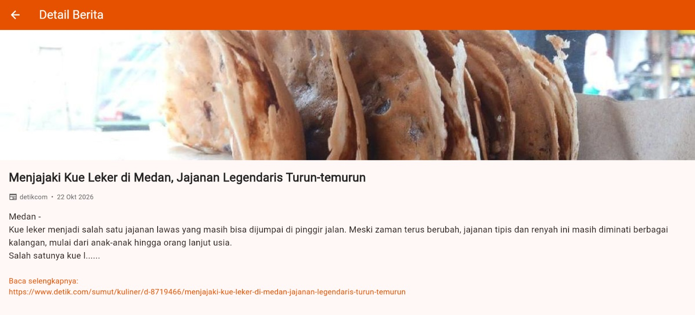
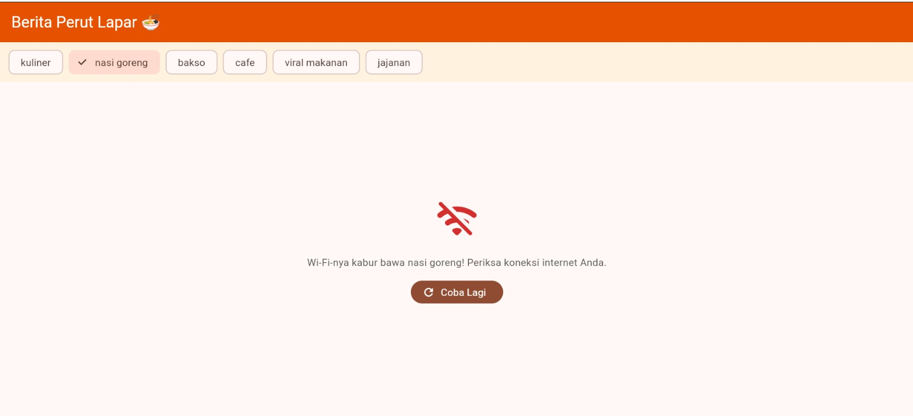
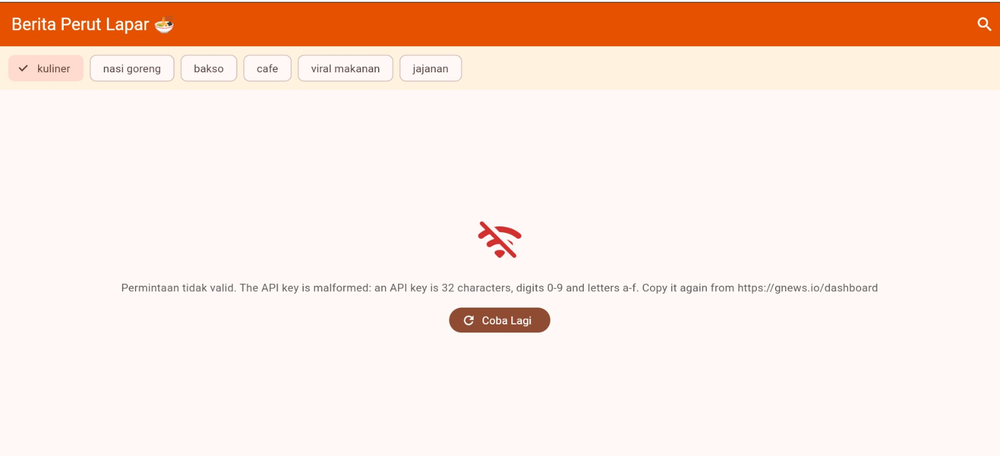

# Berita Perut Lapar 🍜

Aplikasi berita kuliner Indonesia berbasis Flutter. Data dari GNews API
(endpoint `/search`), ditampilkan dengan `FutureBuilder`.

## Fitur
- Daftar berita dengan chip kata kunci (kuliner, nasi goreng, bakso, cafe, dst.)
- Pencarian bebas lewat ikon di AppBar (dialog, lalu halaman hasil dengan FutureBuilder)
- Cache per kata kunci (`Map<String, Future<List<ArticleModel>>>`) untuk menghemat kuota
- Halaman detail berita
- Pull-to-refresh
- Empat state: loading, error, kosong, data
- `ApiException` dengan pesan error berbeda (timeout, tanpa internet, 400, 401, 403, 404, 429, 5xx, data tidak valid)
- Tombol **Coba Lagi** pada tampilan error

## Struktur
- `lib/models` : ArticleModel, NewsResponseModel
- `lib/services` : NewsApiService (Dio), ApiException, PesanError
- `lib/views` : HomeView, SearchView, DetailView
- `lib/widgets` : ArticleCard, ErrorView, NewsImage
- `lib/routes`, `lib/controllers`, `lib/utils`, `lib/config`

## Cara Menjalankan
1. Daftar di https://gnews.io dan salin API key (verifikasi email dulu).
2. Salin `config/env.example.json` menjadi `config/env.json`, lalu isi:
   ```json
   {
     "GNEWS_BASE_URL": "https://gnews.io/api/v4",
     "GNEWS_API_KEY": "API_KEY_ANDA"
   }
   ```
3. Jalankan:
   ```bash
   flutter pub get
   flutter run -d chrome --dart-define-from-file=config/env.json
   ```

`config/env.json` tidak di-commit (ada di `.gitignore`).

## Screenshot

### Daftar berita


### Detail berita


### Error 1: tanpa internet


### Error 2: API key salah
